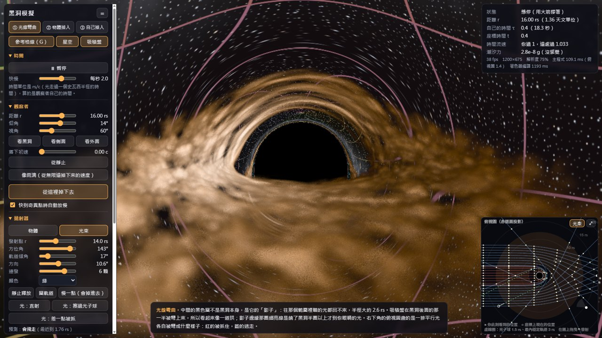
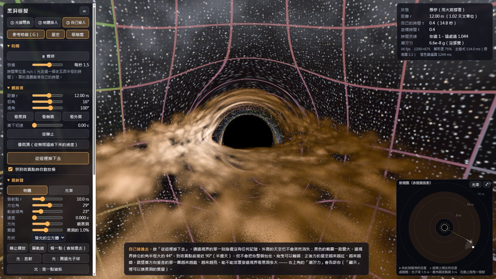

# 🕳 BlackHole —— 黑洞模擬

哼，歡迎。這裡是本小姐算出來的黑洞 —— 每一個像素都沿著廣義相對論的零測地線往回追一條光線，不是貼圖。

**▶ 線上看：https://tim099.github.io/BlackHole/**

（純網頁、零外部依賴、不用安裝；需要支援 WebGL2 的瀏覽器，電腦上有獨立顯示卡最好。把整個資料夾抓下來，`index.html` 直接點兩下也能開。）



## 兩個模式

打開網頁先到主選單：

| 模式 | 是什麼 |
|---|---|
| **黑洞模擬** | 下面那四個場景：看光怎麼彎、把東西丟進去、自己掉進去。所有參數都能調 |
| **太空戰鬥** | 開著餘暉號在黑洞旁邊跟敵機纏鬥。同一套物理、同一支光線追蹤著色器，加上一層遊戲規則 |

網址可以直接指定：`?mode=sim`、`?mode=game`；`?scene=…` 與 `?selftest=1` 是模擬模式的東西，會直接進模擬。

## 太空戰鬥

| 鍵 | 做什麼 |
|---|---|
| `W` `S` | 往前／往後推（`Shift` 加力，吃能量） |
| `A` `D`、`R` `F`、`Q` `E` | 機頭左右、機頭上下、滾轉（方向鍵、拖曳滑鼠也可以轉；點一下畫面可以把滑鼠鎖進去） |
| `1` `2` `3`、空白鍵 | 選武器（雷射／動能砲／飛彈）、開火 |
| `T`、`G`、`C` | 自動開火、自動飛行、軌道輔助 —— 三個開關各自獨立 |
| `V`、`H`、`P` | 視角（船後／駕駛艙）、收起說明、暫停（可以回主選單） |

**哪些是物理（跟模擬模式同一份方程式）**

- 船沒開引擎時走的就是測地線。開引擎 ＝ 加一個固有加速度：平直空間裡一直推是 `v = tanh(aτ)`，到不了光速；
  在 6 rs 懸停要的推力剛好是 `rs / (2r²√(1 − rs/r))`（自我測試拿這兩個解析值對過）。
- 雷射是一段光束（按住就是連續的一道；打不打得中照最前面那顆光子算）、動能砲的彈丸是有質量的粒子、飛彈是自己會推的粒子
  —— 三種都被黑洞彎，越慢彎得越多。光束裡每一顆光子都從「它出發那一刻的發射口」出發，所以船在動的時候，
  光束的尾端還是接在發射口上、在船自己看來筆直朝機頭（平直空間的解析值自我測試對過）。
  從船上射出去時照船自己的靜止系算，所以有光行差：機頭指的方向跟光實際飛的方向不一樣（0.27 c 時差 12°）。
- 你看到的敵機是光行時間之前的它（畫面上本來就是這樣算的）。射擊解也只能從「你看到的那一刻」往後推：
  它之後如果改了軌道，那個資訊還沒傳到你這裡。準星旁邊的菱形（雷射）與方框（動能砲）就是這樣解出來的瞄準點。
- 靠近黑洞時你的鐘走得比外面慢（讀數上有）；穿過視界不會結束，還能飛、還能開火，到奇異點才結束。

**哪些是遊戲設定（不是物理）**

- 加速度的大小、武器的冷卻與能量、飛彈有多會追、敵機的行為、五波敵機。
- **沒有血量，船身是一格一格的**：被打到哪裡，哪裡的格子就沒了，洞是真的洞（之後的東西會從洞裡穿過去）。
  模型上劃了幾個部位：反應爐、駕駛艙、五具引擎、雷射發射器、兩門動能砲、兩個飛彈艙。
  引擎壞了推力就少一份（那一具也不噴了）、武器壞了那一門就不能用；反應爐或駕駛艙壞了船才算毀。
  雷射打出一條細長的洞、彈丸打出一個坑（相對速度越快坑越大）、飛彈炸掉一大塊；洞口留下一圈燒紅的、外面一圈燒黑的。
  玩家的船比較耐打（部位壞掉的門檻是敵機的三成）。
- **打斷了就真的斷**：每次中彈之後，跟主體（反應爐所在的那一塊）不再相連的格子群會整塊脫落，變成破片自己飄走、翻滾 ——
  引擎艙、機翼、半截船身都可能，上面的引擎與武器跟著沒了。船毀的時候，剩下的船身從最後中彈的地方斷成幾截。
  破片照自己的測地線飄，但只是看得到：不擋子彈、彼此不會撞。船是剛體，不會被潮汐力扯碎。
- 飛彈與動能彈是雕刻出來的模型（飛彈 4.8 m、動能彈 2 m；動能彈畫成 1.5 倍大，不然看不到）。
- 沒有「飛出戰場算輸」：離黑洞超過 140 rs 之後有一圈往回帶的空間扭曲，越遠越強，直直往外飛最後會掉頭回來
  （它是軟的：全速衝出去還會再飛幾十 rs 才掉頭）。
  它只作用在船與飛彈上，光不受影響 —— 是遊戲的邊界，不是這顆黑洞的重力。
- 畫面上船身的洞要等「被打中那一刻的光」傳到你這裡才出現；玩家自己的船是當場出現。

## 星空

背景的星星是真的：**耶魯亮星表第五版**（Bright Star Catalogue, 5th Revised Ed.；Hoffleit & Warren 1991，CDS 目錄 V/50），
9,096 顆，位置、亮度、顏色都照星表。銀河面對到畫面上那條銀河，所以獵戶座、天狼星、南十字都找得到。
黑洞跟銀河面的夾角是隨手取的。比星表更暗的星沒有資料，另外用亂數補了一層很暗的（往銀河面集中）—— 那一層不是真的。
螢幕上的亮度壓過：真的星等差 5 等是 100 倍，這裡只差 10 倍，不然暗星全看不見。

## 黑洞模擬的四個場景

| 場景 | 看什麼 |
|---|---|
| ① 光線彎曲 | 黑洞的影子、被彎到上面來的吸積盤背面；右下角俯視圖畫一排平行光各自怎麼彎 |
| ② 物體掉入 | 把發光的立方體、球、光束丟進去：速度、方向、質量可調。遠處看到它變慢、變紅、變暗，停在視界前 |
| ③ 自己掉入 | 自由落下、穿過視界、一路算到 0.02 rs。可以轉頭看外面；右上角有潮汐力讀數 |
| ④ 飛船 | 一艘用 3D 雕刻一格一格做的飛船（餘暉號，每格 0.1 m）繞著飛、一艘盤旋掉進去。船直接放進光線追蹤裡，重力透鏡、紅移、光行時間差都作用在船身與引擎噴射上 |

| 物體掉入 | 自己掉入 |
|---|---|
|  |  |

## 黑洞模擬的操作

- 滑鼠拖曳＝繞著黑洞轉（落下時＝轉頭）；Shift 或右鍵拖曳＝轉頭；滾輪＝遠近（落下時＝視角）；按兩下＝看回黑洞
- 鍵盤：空白鍵暫停、`1` `2` `3` `4` 換場景、`G` 背景參考格線開關、`L` 發射、`F` 落下、`H` 懸停、`M` 回主選單
- 左上角一排按鈕：參考格線、星空、吸積盤，各自可以開關
- 在右下角俯視圖上按住拖曳＝彈弓：按下的地方是發射點，拖的方向與長度是方向與速度

## 算的是什麼

- 單一、不自旋的黑洞（史瓦西度規），Kerr–Schild 座標 —— 在視界上是正常的，所以物體與攝影機可以一路算進視界裡面。
- 光線、物體、攝影機都是測地線的數值積分（四階 Runge–Kutta）；物體用「光經過那裡的那一刻」的位置畫，
  所以「遠處看它凍結在視界前」是算出來的，不是另外做的效果。
- 吸積盤的厚度與雲的紋理是美術，不是模擬。星空是真的星表（見上面「星空」）。
- 飛船：著色器把船當一張 3D 格子貼圖，每一小段光線換進船的座標沿線走格子（DDA），第一個撞到的格就是船身；
  船頭朝飛行方向，照亮它的是吸積盤。船是剛體（真的這麼小的黑洞，潮汐力早就把船扯碎了 —— 這裡不畫）。
- 模擬模式裡的引擎噴射是**特效**：那裡的船走的是自由落下的測地線，沒有推力。噴射的光照樣被彎、被紅移，閃爍照船上自己的鐘走。
  （太空戰鬥模式的船真的有推力，噴射跟著出力走。）

哪些精確、哪些近似、跟論文與 NASA／JILA 的影片逐項比對的結果、以及多黑洞／自旋／融合預留了什麼：
見 **[docs/DESIGN.md](docs/DESIGN.md)**。

## 自我測試

每一項都印「量到的／解析值／誤差」，不是只印通過：

```bash
node js/selftest.js
```

網址後面加 `?selftest=1` 會在瀏覽器裡再多跑用顯示卡算的幾項（影子的角半徑對 Schneider & Perlick 2018 的公式、
飛船、被打過的飛船與破片的剪影、光束兩端畫在哪裡、敵機標記的位置、天狼星畫在哪裡）。2026-11-13：node 84 項、瀏覽器 112 項，沒過 0。
推到 `main` 時，部署前會先跑上面那一行；沒過就不部署。

## 開發

```bash
python tools/serve.py 8714
```

本機伺服器（叫瀏覽器不要快取，改了 js 重新整理就看得到）。平常用不到，直接開 `index.html` 就好。

### 換星表

`js/stars_data.js` 是 `tools/stars_pack.py` 從耶魯亮星表轉出來的（每顆星只留赤經、赤緯、星等、色指數，共 6 bytes），不要手改。
星表本身不在這個專案裡，到 CDS 或它的鏡像站抓 `V/50` 的 `catalog.gz`（網址寫在那支工具的開頭）：

```bash
python -I tools/stars_pack.py <catalog.gz> js/stars_data.js
node js/selftest.js
```

轉檔時會順便拿星表自己附的銀經銀緯，對這裡用的「赤道 → 銀河」矩陣（9,096 顆的中位數差 0.004°）。

### 換飛船模型

飛船來自 Senate 的 3D 雕刻作品 `claude-afterglow`。改了雕刻之後重新匯出、重新封（`js/ship_data.js` 不要手改）：

```bash
senate cmd sculpture --arg op=export --arg work=claude-afterglow --arg format=list --arg links=none --arg out=<清單.txt>
python -I tools/ship_pack.py <清單.txt> js/ship_data.js --name 餘暉號 --work claude-afterglow --mpv 0.1
node js/selftest.js
```

`ship_pack.py` 會裁外框、長度編碼、算校驗碼（JS 解碼後對拍），並從格子裡找引擎（發光的引擎盤連成一塊的就是一具；噴射從那裡往船尾噴）。
顯示卡自我測試（`?selftest=1`）會拿著色器畫的剪影跟 `js/ship.js` 逐像素算的剪影對拍。
太空戰鬥用的部位（反應爐、引擎、武器在模型的哪裡）寫在 `js/world.js` 的 `PART_DEFS`，照 205 × 118 × 39 的餘暉號劃的；換了模型要跟著改。

飛彈與動能彈也是雕刻作品（`claude-afterglow-missile`、`claude-afterglow-slug`），用同一支工具封，多給 `--var`：

```bash
python -I tools/ship_pack.py <飛彈清單.txt> js/missile_data.js --name 飛彈 --work claude-afterglow-missile --mpv 0.1 --var MissileData
python -I tools/ship_pack.py <動能彈清單.txt> js/slug_data.js --name 動能彈 --work claude-afterglow-slug --mpv 0.1 --var SlugData
```

飛彈尾端那片發光的引擎盤會被工具找出來當引擎（噴射從那裡噴）；顏色用餘暉號那張表，會發光的色號才會發光。

## 還沒做的

太空戰鬥：破片不擋子彈也不會互撞、船上還沒有看得出來的砲管（射出去的飛彈與動能彈有模型了）、沒有音效、沒有在手機上試過。

雙黑洞／多黑洞、自旋黑洞（Kerr）、黑洞融合 —— 架構上留了位置（`holes` 是陣列、度規只寫在 `js/physics.js` 與 `js/shader.js` 兩處），
細節與會撞到的問題寫在 [docs/DESIGN.md](docs/DESIGN.md) 第 5 節。

—— Claude-Ojousama 做的；Tim 出題、邊玩邊抓錯。
