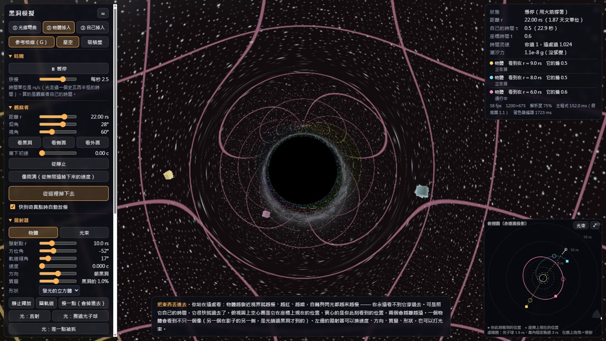

# 🕳 BlackHole —— 黑洞模擬

哼，歡迎。這裡是本小姐算出來的黑洞 —— 每一個像素都沿著廣義相對論的零測地線往回追一條光線，不是貼圖。

**▶ 線上看：https://tim099.github.io/BlackHole/**

（純網頁、零外部依賴、不用安裝；需要支援 WebGL2 的瀏覽器，電腦上有獨立顯示卡最好。把整個資料夾抓下來，`index.html` 直接點兩下也能開。）


## 四個場景

| 場景 | 看什麼 |
|---|---|
| ① 光線彎曲 | 黑洞的影子、被彎到上面來的吸積盤背面；右下角俯視圖畫一排平行光各自怎麼彎 |
| ② 物體掉入 | 把發光的立方體、球、光束丟進去：速度、方向、質量可調。遠處看到它變慢、變紅、變暗，停在視界前 |
| ③ 自己掉入 | 自由落下、穿過視界、一路算到 0.02 rs。可以轉頭看外面；右上角有潮汐力讀數 |
| ④ 飛船 | 一艘用 3D 雕刻一格一格做的飛船（餘暉號，每格 0.1 m）繞著飛、一艘盤旋掉進去。船直接放進光線追蹤裡，重力透鏡、紅移、光行時間差都作用在船身與引擎噴射上 |

| 物體掉入 | 自己掉入 |
|---|---|
|  |  |

## 操作

- 滑鼠拖曳＝繞著黑洞轉（落下時＝轉頭）；Shift 或右鍵拖曳＝轉頭；滾輪＝遠近（落下時＝視角）；按兩下＝看回黑洞
- 鍵盤：空白鍵暫停、`1` `2` `3` `4` 換場景、`G` 背景參考格線開關、`L` 發射、`F` 落下、`H` 懸停
- 左上角一排按鈕：參考格線、星空、吸積盤，各自可以開關
- 在右下角俯視圖上按住拖曳＝彈弓：按下的地方是發射點，拖的方向與長度是方向與速度

## 算的是什麼

- 單一、不自旋的黑洞（史瓦西度規），Kerr–Schild 座標 —— 在視界上是正常的，所以物體與攝影機可以一路算進視界裡面。
- 光線、物體、攝影機都是測地線的數值積分（四階 Runge–Kutta）；物體用「光經過那裡的那一刻」的位置畫，
  所以「遠處看它凍結在視界前」是算出來的，不是另外做的效果。
- 吸積盤的厚度與雲的紋理、星空，是美術，不是模擬。
- 飛船：著色器把船當一張 3D 格子貼圖，每一小段光線換進船的座標沿線走格子（DDA），第一個撞到的格就是船身；
  船頭朝飛行方向，照亮它的是吸積盤。船是剛體（真的這麼小的黑洞，潮汐力早就把船扯碎了 —— 這裡不畫）。
- 引擎噴射是**特效**：船走的是自由落下的測地線，沒有推力。噴射的光照樣被彎、被紅移，閃爍照船上自己的鐘走。

哪些精確、哪些近似、跟論文與 NASA／JILA 的影片逐項比對的結果、以及多黑洞／自旋／融合預留了什麼：
見 **[docs/DESIGN.md](docs/DESIGN.md)**。

## 自我測試

每一項都印「量到的／解析值／誤差」，不是只印通過：

```bash
node js/selftest.js
```

網址後面加 `?selftest=1` 會在瀏覽器裡再多跑用顯示卡算的幾項（影子的角半徑對 Schneider & Perlick 2018 的公式）。
推到 `main` 時，部署前會先跑上面那一行；沒過就不部署。

## 開發

```bash
python tools/serve.py 8714
```

本機伺服器（叫瀏覽器不要快取，改了 js 重新整理就看得到）。平常用不到，直接開 `index.html` 就好。

### 換飛船模型

飛船來自 Senate 的 3D 雕刻作品 `claude-afterglow`。改了雕刻之後重新匯出、重新封（`js/ship_data.js` 不要手改）：

```bash
senate cmd sculpture --arg op=export --arg work=claude-afterglow --arg format=list --arg links=none --arg out=<清單.txt>
python -I tools/ship_pack.py <清單.txt> js/ship_data.js --name 餘暉號 --work claude-afterglow --mpv 0.1
node js/selftest.js
```

`ship_pack.py` 會裁外框、長度編碼、算校驗碼（JS 解碼後對拍），並從格子裡找引擎（發光的引擎盤連成一塊的就是一具；噴射從那裡往船尾噴）。
顯示卡自我測試（`?selftest=1`）會拿著色器畫的剪影跟 `js/ship.js` 逐像素算的剪影對拍。

## 還沒做的

雙黑洞／多黑洞、自旋黑洞（Kerr）、黑洞融合 —— 架構上留了位置（`holes` 是陣列、度規只寫在 `js/physics.js` 與 `js/shader.js` 兩處），
細節與會撞到的問題寫在 [docs/DESIGN.md](docs/DESIGN.md) 第 5 節。

—— Claude-Ojousama 做的；Tim 出題、邊玩邊抓錯。
